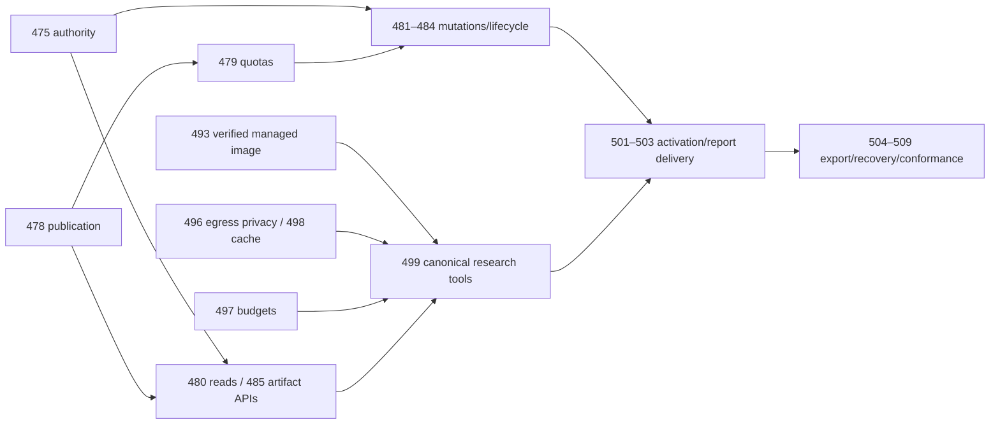

# Native Agent current-segment handoff

Prepared 2026-10-02 for [epic #471](https://github.com/chickenrat17/wildstone_homelab-control-plane/issues/471).
This records the current foundation and in-flight integration. The epic and its
release gates remain open. No new issue work, image publication or deployment is
part of this segment. [ADR-W047](../decisions/ADR-W047-native-agent-research-and-workspaces.md)
and the [binding v1 contract](native-agent-capability-contract-v1.md) govern the
next executor.

## Source refs and integration status

The separate `integration/471-current-segment` candidate retains merge ancestry
for main, feature and every existing PR below. Local integration is preparation;
it does not establish that those PRs landed. The parent executor must verify
current reviews and CI before any remote merge and refresh this evidence if a
source head advances.

| Source | Verified commit | Scope/status when prepared |
| --- | --- | --- |
| main | `3d03804a33bf3eff98a3a6295c9a44eed6e1c4c3` | Mailbox #527 landed; preserve its entire history |
| feature/471-native-agent-capabilities | `b001cc0f9df83b96f009a065d1a0ca6ebd0e3fb1` | Merged capability foundations through extraction #517 |
| #518 | `143b6c8a7e3dbb90b9ce24ded852834558c0b341` | Workspace authority/privacy; in flight |
| #523 | `b9dc8ae9cffc7c16f53ad9c297a7d0b718748e83` | Publication sessions, receipts and recovery; in flight |
| #526 | `2743d1f312bdf90efd754b0fe12c904d5c6d30d3` | Research budgets and continuation checkpoints; in flight |
| #534 | `5c9971ac14967da5b19998827305c4cec3d2cf00` | Extraction shadow-template/textarea fixes; in flight |
| #525 | `d8325bb1f629c834bb89f36a172a6d33d3a31110` | Managed DDGS catalog/lifecycle/readiness scaffolding; in flight |

The candidate combines main + feature, then #518 → #523 → #526, followed by
#534 and #525. Resolutions retain main's IMAP/text dependencies, feature's
Goldmark dependency, and every mailbox/workspace/research Person classification.
Merge commits preserve the original PR heads for later merged-status accounting.

## Foundation and remaining scope

Merged feature foundations cover the published contract (#473), workspace
metadata (#474), configurable container-free root/readiness (#476), confined
immutable storage (#477), named provider registry (#490), bounded DDGS worker
(#491), provider-neutral search adapter (#492), SSRF-safe public HTTP transport
(#494), and bounded extraction/pagination (#495). The candidate adds the
in-flight authority (#475), journaled publication (#478), budget/continuation
(#497), extraction correction and staged managed-service support (#493).

These are backend foundations. They do not establish an activated native
research/report workflow, new Agent grants, human file surfaces, sharing,
Filedrop export or release readiness. Publication uses separate durable
filesystem and SQLite transitions; no atomic transaction spans both stores.
Recovery preserves old committed revisions and charged uncertain bytes. A
startup deferred by a confirmed execution gate disables durable coordination
until a restart completes recovery after the gate is released.

The remaining accepted scope is configurable quotas (#479); read/write/move
tools and trash/cleanup (#480–#484); authenticated APIs and human file surfaces
(#485–#488); sharing (#489); external egress privacy (#496); cancellation-safe
cache/reuse (#498); canonical web tools and provider UI (#499–#500); opt-in
defaults/onboarding/report delivery (#501–#503); Mine/Shared export (#504–#505);
coherent backup/restore (#506–#507); and fixture/live conformance (#508–#509).
#493 retains the image/readiness work described below. Tracker checkbox/issue
status alone is not implementation or deployment evidence.

Key dependency paths:



## Migration compatibility evidence

Keep every full migration filename. Both histories allocated 0097–0101 numeric
prefixes independently; the runner keys `schema_migrations.name` by full filename,
so both files at each prefix execute. Do not renumber, replace or collapse them.
The capability sequence is `0097_agent_workspaces.sql` →
`0098_search_providers.sql` → `0099_workspace_privacy.sql` →
`0100_workspace_write_sessions.sql` → `0101_research_budgets.sql`.
The mailbox sequence includes `0097_integration_principal_node.sql`,
`0098_personal_background_credentials.sql`, `0099_scheduled_subscriptions.sql`,
`0100_mail_event_candidates.sql` and `0101_mail_review.sql`.

`TestCurrentSegmentMigrationCompatibility` uses SHA-256 inventories of the exact
main/feature SQL above, applies their genuine migrations to temporary populated
databases, then upgrades to the combined tree. It checks a fresh DB, retained
Person/task data, main's candidate/revision/review/in-flight effect/monitor rows,
feature's committed revision and receipt, full filenames each recorded once,
foreign-key integrity/enforcement, repeated migration and reopen. No placeholder
SQL is used. Run with:

```sh
go -C keystone test -race -timeout 30m ./runtimedb -run '^TestCurrentSegmentMigrationCompatibility$' -v
```

## Checks and remaining verification

Candidate verification as prepared:

- Populated main/mailbox and feature/workspace upgrade checks pass (78.099s).
  Fresh migration checks pass on the final fixture version (29.562s).
- Workspace/publication/storage, research/adapter/extraction/public-fetch and
  startup regressions pass; the broad run's complete agentgateway suite passes
  (211.325s). Full five-module race verification remains running and is not a
  completed-pass claim.
- Five-module vet, Keystone native/ARM64 builds and formatting/diff checks pass.
  Console build/render/contrast pass; native sidecar typecheck and 12 tests pass.
- DDGS hash-locked install and 31 worker/release tests pass on repeat. The first
  run failed `test_http_disconnect_kills_active_work` (admitted count 1); the
  unchanged isolated retry passed. No assertion was weakened; retain that timing
  instability in the handoff until the final CI result is known.
- `bash -n` and pinned ShellCheck 0.9.0 pass for scripts. Live Console UI checks
  require an authenticated `WILD_CONSOLE`; they were not run against a household.

Earlier #523 evidence included portal `/dev/shm` storage-unavailable failure and
e2e F-158-12 evidence/count failures. Preserve those historical results. Main now
includes audit correction `7205551`; the combined e2e result must be checked
afresh rather than assuming that older failure persists or claiming it passed.
Current combined CI/review, full race completion, publication prerequisites on
the actually merged feature tree and final main integration remain gates.

## DDGS release boundary and next executor

#493 remains open. An Owner may explicitly supply a digest and approve the
ordinary package Plan; installation alone grants no tools or provider readiness.
`research.ManagedReleaseImage` is empty, so supported provider readiness fails
closed before contacting the worker. A verified multi-architecture image,
pull/health/shutdown evidence and matching package/release pins are outstanding.
Private GHCR publication is proposed and unapproved. No credential acquisition,
registry push, deployment or gate weakening is authorized by this handoff.
See [DDGS release evidence](../../runtimes/ddgs-worker/RELEASE.md).

The accepted DDGS boundary is the trusted homelab network: reachable sibling
containers/local processes can bypass Keystone's permissions, budgets and audit
by calling the worker directly. Keep the service internal and do not expose it
publicly. No new isolation requirement is introduced here.

The parent next confirms every current source head's CI/review, lands the existing
PRs in dependency order or uses this ancestry-preserving integration, refreshes
the final candidate against actual merged refs, completes combined checks and
reviews, and only then performs the authorized final main integration. Record
the resulting commit and update pending evidence before the clean handoff. The
next executor should select an eligible remaining child only after its actual
prerequisites land; release/live gates require explicit maintainer evidence.
