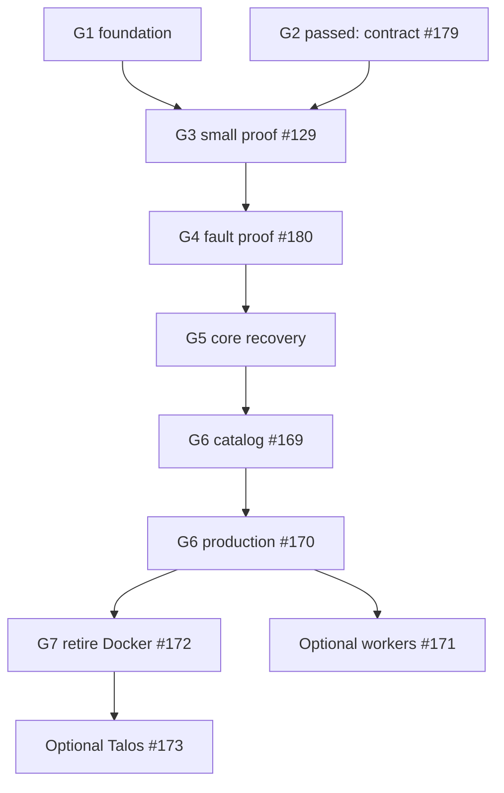

# W050 migration plan: from Docker to Kubernetes (k3s)

- **Status:** proposed plan for owner review. Documentation only. No implementation or runtime change is authorized by this document. Slice issues exist (all `agent:blocked`) so the owner can schedule them.
- **Date:** 2026-10-24, against `main` at `5a81358`.
- **Governed by:** [ADR-W050](../decisions/ADR-W050-multi-node-runtime-kubernetes-engine-host-providers-editions.md) (accepted). Respects [ADR-W051](../decisions/ADR-W051-failure-domains-and-recovery.md) (proposed) as requirements.
- **Slice issues:** [`w050-slices/`](w050-slices/), one file per slice; created on GitHub as #157 (slice 0), #151 (slice 1, existing) and #158–#173 (slices 2–17).
- **Evidence rule:** claims cite `path:line` on `5a81358`. Anything marked **(inferred)** was not verified in code or on a machine; it is for #129 or the slice to prove.

## Implementation review and proof gates — 2026-10-24

Issue and slice numbers remain stable identifiers, not an execution sequence. The gates below and §7 define the current dependencies and decision exits. Historical code inventory remains evidence against the cited revision, not a fresh code audit.

### Work already in progress
#177 merged as `97628db`: Docker-only encapsulation is complete. Docker-shaped types are not the Kubernetes contract. G2 passed: the owner accepted #179 in merged #182. #178 merged as `c6860f4`; it implements release 1 parser support and opt-in lint for `devices`/`deployment`, with no catalog edits or runtime effect.

### Revised execution gates

The maintainer/owner records **pass, revise, or reject** in the named issue. A passing test is necessary evidence, not implicit owner acceptance or scheduling. Revise reopens the specified work; reject pauses dependent migration. No new gate is added automatically.

| Gate | Decides | Evidence that passes | Revise returns to / what may proceed |
|---|---|---|---|
| G1 — foundation (#157/#151/#158) | Owner schedules bounded refactors and accepts their PRs | #177 merged; #157 immutable-revision/bounded-approval crash and concurrency tests; #158 unchanged Plans, Docker ordering, e2e and exit drill | Failed refactor returns to #157 or #158. **#158 may start after merged #177 when scheduled, in parallel with #179**; it does not consume availability or wait for deployment proof. |
| G2 — capability contract (#179) — **PASSED 2026-10-24** | Owner accepted #179 in merged #182 | [Accepted contract](package-deployment-capabilities-contract.md), including §9 owner decisions; #178 (merged `c6860f4`) implements release 1 parser support and opt-in lint for devices/deployment, with no catalog edits | Contract gate is complete. Implementation findings return to #178; changes to accepted semantics require an explicit contract amendment. #158 continues independently. |
| G3 — small single-node proof (#129) | Owner records pass/revise/reject in #129 | Small disposable deployment with **1–3 migrated services**, including Uptime Kuma as the stateful case; tools-it-tools and one optional Mealie/Postgres fixture. For each selected service: forward migration, new write where stateful, rollback preserving it, install/update/reboot/front-door results and measured outage. Stateful case also passes consistent backup and replacement restore. #159–#164 and early #168 proof evidence complete. | Return to failing #159–#164 or early #168 child; reopen #179 if semantics failed. Reject stops core/catalog migration. #164 alone cannot close #129. Docker identity may remain. |
| G4 — early multi-node safety (#180) | Owner accepts reproducible disposable-cluster evidence in #180 | G1–G3 passed; same limited service set plus management fixture on three node VMs. Power loss, partition, old-node return, stale leader/apply, single-writer storage, secret continuity and backup placement pass; topology/versions/outage/data-loss measured. Contract review happens before implementation, fault evidence after #163. | Return to #180 contract/harness or failing #159/#161/#162/#163 child; reopen #179 if capability assumptions fail. No #169 or #170 dependency. VMs on one host establish no independent hardware/power protection. |
| G5 — core and household migration (#165/#166/#168) | Owner accepts core recovery and supported household migration evidence | G3/G4 accepted; ingress/identity cutover, actual Keystone power-loss/partition/secret-revocation continuity, host/off-host recovery without Keystone, and household migration rollback proven; #167 covers required hardware variants | Return to failing #165/#166/#167/#168 child. Actual Keystone recovery is required before household migration is offered; fixture success alone is insufficient. |
| G6 — catalog and production multi-node (#169/#170) | Owner accepts each bounded wave and supported topology | G2–G5 passed; package lifecycle/admission/backup evidence for each wave; then Console join, role conversion, rolling host updates, safe leader handover and truthful protection status | Return to affected package/#169/#170 child; architectural failures reopen #180. Wave support is not mass migration approval. |
| G7 — retirement and optional expansion (#172/#171/#173) | Owner explicitly accepts deprecation/upgrade decision; separately schedules optional features | #168/#169/#170 evidence, supported single/multi-node replacement restore, existing Docker upgrade/rollback and warning release before #172. #171 requires #179/#170 plus replica/worker-specific tests. Talos needs #172 and a new accepted ADR. | Return to #168/#170/#172 and retain Docker compatibility on retirement failure; replica/worker failures return to #171; Talos to #173. Optional expansion is not a prerequisite for Docker retirement. |

Authority and secret-custody design portions of #180 are reviewed **before** #159/#162 implementation; its fault evidence is collected **after** those slices. This separates design prerequisites from test completion and avoids a cycle.

### Capability contract (#179)

See the [accepted package deployment capabilities contract](package-deployment-capabilities-contract.md), including its §9 owner decisions (accepted in #182; G2 passed).

### Authority, storage and recovery contract (#180)
- Keystone is the sole product-level desired-state/approval authority; Kubernetes controllers implement that intent. Bootstrap and emergency recovery are explicit audited exceptions.
- A Lease coordinates leadership; it is not fencing. Define cancellation, stale/in-flight request handling, revision checks, replay/idempotency and safe resumption before promising one effective writer.
- Separate administrative bootstrap/break-glass credentials from least-privilege runtime credentials. Server root/admin kubeconfigs remain authority regardless of who currently loads them. Runtime credentials must not alter admission/RBAC or mint their own signed-package grants. Admission protects against malformed workloads; it is not a security boundary against unrestricted cluster-admin compromise.
- Specify canonical secret storage, leader handover access, version continuity, export/import and encryption-key recovery. A missing local leader store must never regenerate existing secrets.
- Prove storage detach/reattach and partition behavior; RWOP plus short tolerations is not a complete fencing contract. State measured downtime instead of deriving it from eviction timeout.
- Host recovery must diagnose/rebuild/restore when Keystone cannot run, with a documented off-host kit when cluster API/storage is unavailable. A proxy to Keystone is not this recovery path.
- Resource priorities reduce risk but do not guarantee management survival of node/PV disk exhaustion. Reserve OS, Kubernetes and storage capacity and test pressure explicitly.

### Rollout and migration corrections
Singleton stateful workloads use Recreate with a declared outage. A failed update cannot keep the already terminated old pod serving. Rollback requires declared schema/data compatibility or validated restore alongside; old image selection alone is insufficient. Replicated stateless continuity is a separate test. Secret rotation uses the applicable workload strategy.

Final consistent data copy requires writers stopped/quiesced; estimate and disclose outage. Pre-copy may reduce it but needs final synchronization and application consistency checks. The initial 1–3-service migration proof is intentionally earlier and smaller than general household migration tooling.

### Sources for safety assumptions

Checked 2026-10-24. Longhorn's official latest URL resolved to the 1.13.0 node-failure page on this date; this is documentation evidence, not a supported runtime version selection.
- [client-go leader election explicitly disclaims fencing](https://pkg.go.dev/k8s.io/client-go/tools/leaderelection).
- [Longhorn node failure and volume attachment](https://longhorn.io/docs/latest/high-availability/node-failure/).
- [Kubernetes force-delete warning](https://kubernetes.io/docs/reference/kubectl/generated/kubectl_delete/).
- [Kubernetes node-pressure eviction](https://kubernetes.io/docs/concepts/scheduling-eviction/node-pressure-eviction/).

No runtime change, merge, or test deployment is executed by this documentation revision. Remaining implementation issues retain their scheduling restrictions.


## Contents

1. [Summary in plain language](#1-summary-in-plain-language)
2. [What must be decided first](#2-what-must-be-decided-first)
3. [Docker coupling inventory](#3-docker-coupling-inventory)
4. [Resource kinds → Kubernetes objects](#4-resource-kinds--kubernetes-objects)
5. [Package survey](#5-package-survey)
6. [Target architecture](#6-target-architecture)
7. [Slices, order and sizes](#7-slices-order-and-sizes)
8. [Test strategy](#8-test-strategy)
9. [Risks and open decisions](#9-risks-and-open-decisions)
10. [The first three slices in detail](#10-the-first-three-slices-in-detail)
11. [Proposed ADR amendments](#11-proposed-adr-amendments)

---

## 1. Summary in plain language

**What changes.** Today Wardstone tells Docker on one machine "run this container". After the migration, one Wardstone (the *leader*) tells Kubernetes "keep this app running somewhere suitable". Kubernetes then restarts it, moves it if a machine dies, and updates it one copy at a time.

**What stays the same.**
- Households still see packages, Plans and "Add a machine". Nobody sees Kubernetes.
- Keystone is still the only thing that decides what should run. Every change is still a Plan.
- Wardstone still accepts only typed operations. There is still no "run this command" (`Exec(string)`).
- Caddy, Authelia/LLDAP, the internal CA, the secret store and restic backups stay. They run *on* Kubernetes.

**A short example.** Installing Mealie today becomes, roughly:

| Today (Docker) | After (k3s) |
|---|---|
| Keystone sends `EnsureContainer(mealie)` to node `mini-1` | Keystone sends `ApplyWorkload(mealie)` to the leader |
| Docker starts one container on `mini-1` | The leader writes a Deployment, a Service and a volume claim; Kubernetes picks a node |
| A host folder holds the data | A Longhorn volume holds the data, copied to a second machine if there is one |
| Caddy finds it as `container/mealie:9000` on the Docker network | Caddy finds it as the Service `mealie:9000` through cluster DNS |
| Backup runs a restic container on `mini-1` | Backup runs a restic **Job** next to the volume |

**The size of the job.** 18 slices (0–17), roughly 12–18 months of part-time work for one maintainer with an agent **(inferred estimate)**. Each slice leaves `main` releasable with the Docker backend still working.

**The order, in one line.** Foundation refactors and parallel capability review → small single-node deployment with 1–3 service migrations → accepted #129 report → early multi-node safety proof #180 → core/management recovery and household tooling → catalog waves and production multi-node → Docker retirement; workers/Talos remain separately scheduled.

**The biggest surprise from reading the code.** #151 puts the seam *inside Wardstone*. That is necessary but not enough. Keystone's reconciler is per-node and speaks Docker's language: it names a node for every resource (`keystone/reconcile/loop/loop.go:685-696`), creates a Docker network (`keystone/reconcile/reconcile.go:1775-1790`), stamps spec-hash labels (`reconcile.go:1727`) and reads Docker container IPs (`keystone/reconcile/ingressaddr.go`). The k3s leader works on the whole cluster, not one node. So a **second, Keystone-side seam** is needed (slice 2) before any k3s code.

---

## 2. What must be decided first

Short list. Full list with recommendations in [§9](#9-risks-and-open-decisions).

| # | Decision | Recommendation | Blocks |
|---|---|---|---|
| D1 | Accept the two-seam design (Wardstone seam #151 **and** Keystone seam, slice 2) | Accept; amend #151's scope note | Slices 1–2 |
| D2 | Typed cluster operations; no raw manifest/command op | Draft in #158; review authority before runtime implementation, refine from #129 evidence | Runtime operation implementation; not Docker-only #158 |
| D3 | Canonical secret source, handover and key recovery | Review #180 custody contract and amend ADR-W012 before #162 | Slice 6 |
| D4 | Shared host folders (`/srv/wildstone/media`, …) on k3s | **Decided 2026-10-24:** a NAS or NFS share is optional on any topology. With one, shared folders live on it (NFS CSI, `ReadWriteMany`) and may move. Without one, they stay on their machine's own disk (a local PersistentVolume under the managed prefix); on several machines those apps stay on that machine. See [§6.6](#66-storage-and-backup) | Slices 5, 13 |
| D5 | Owner-operated test runner | Owner-run disposable cluster evidence under ADR-W002; no hosted-agent homelab access | #180 and slice 14 |
| D6 | #128 G1/G2 before slice 3 | Yes. The leader will act on approvals across machines | Slice 3 |
| D7 | Accept ADR-W051 (with the small changes in §11) | Accept before slice 10 | Slice 10 |

---

## 3. Docker coupling inventory

**Legend:**
- **Seam:** Docker dependencies are encapsulated; the Kubernetes workload contract is designed separately and need not emulate Docker methods.
- **Rewrite:** has no Docker-free shape and needs new code for k3s.
- **Host:** stays a per-node Wardstone host operation on every backend.
- **Gone:** disappears with the Docker backend (slice 16).

### 3.1 Wardstone (`wardstone/internal/agent/`)

| Code | What it does today | Under k3s |
|---|---|---|
| `docker.go:27-498` | Raw Docker Engine API client over the socket | **Gone** (only the Docker backend uses it) |
| `agent.go:190,252,286` | `DockerEndpoint` config; builds the Docker client at start | **Seam:** choose backend at start; Docker or leader-k8s client |
| `ops.go:45-243` | One switch over 38 op arms (`proto/wardstone/v1/wardstone.proto:104-146`) | **Seam:** container/volume/network/image arms go to the backend; host arms stay |
| `ops.go:535-801` `ensureContainer` | Digest check, mount checks, secret env, devices, caps, limits, host network, replace-on-spec-hash, port read-back | **Seam** for Docker. **Rewrite** for k3s as `ApplyWorkload` (leader only). Pre-checks (digest, allowlists) are shared |
| `ops.go:861-1027` stop/logs/pull/remove/stats/inspect/prune | Container lifecycle | **Seam**. k3s: scale-to-0, pod logs, (no pull: kubelet pulls), delete, metrics-server, rollout status, containerd image GC (#136) |
| `ops.go:1028-1076` `ensureVolume`, `ensureDockerNetwork` | Named volume; one shared `wildstone` network | **Seam** → PVC (Longhorn). Network → **Gone** (cluster network + NetworkPolicy, #42) |
| `resources.go:24-90` | Docker size and CPU parsing, cap-drop checks | **Seam:** shared validation; k3s maps to `resources` and `securityContext` (#41) |
| `devices.go:93-99` host system mounts; device/cap allowlists | Closed allowlists (`/dev/dri`, serial, `/run/dbus`, …) | **Host + admission:** the allowlist becomes ValidatingAdmissionPolicy input; devices via device plugins ([§6.7](#65-policy-and-admission)) |
| `registryauth.go` | Private-registry credential read from the node store, per pull | **Rewrite:** imagePullSecret written by the leader (k3s) |
| `seed.go:75` | Finds the Docker volume mountpoint; O_EXCL write-if-absent | **Rewrite:** init container with a Wildstone seeder image ([§4](#4-resource-kinds--kubernetes-objects)) |
| `diskspace.go:30` | Volume mountpoint → free space | **Seam:** k3s reads Longhorn volume capacity |
| `hostaliases.go`, `ops.go:761` | Node resolves names (MagicDNS) into container `/etc/hosts` | **Rewrite:** CoreDNS stub zone for the tailnet domain **(inferred, prove in slice 4)** |
| `secrets.go`, `materialize.go` | Sealed per-node store; values substituted into Docker env and managed files | **Host** for the store; **Rewrite** for delivery: leader writes Kubernetes Secrets (D3) |
| `readiness*.go`, `radios*.go` | Host IPv6, multicast, D-Bus, BlueZ, tun, radio inventory | **Host:** unchanged; results also become node labels |
| `mount_linux.go`, `fstab.go`, `blockdevices_*.go` | NFS mount + fstab, block devices | **Host** for diagnosis. App storage moves to NFS CSI; `EnsureMount` stays only for host needs **(inferred)** |
| `systemd_linux.go`, `agent.go:204` | Unit status; allowlist defaults to `wardstoned`, `docker` | **Host:** allowlist becomes `wardstoned`, `k3s`/`k3s-agent` |
| `selfupdate.go`, `updatestate.go` | Signed A/B self-update | **Host:** kept; also driven by `RunPlaybook("wardstone-update")` in rollouts |
| `fsops.go`, `listdir.go`, `netprobe.go`, `ports_*.go`, `facts_*.go`, `timesync_*.go` | Snapshot, usage, probes, ports, facts | **Host:** unchanged |
| `audit.go` | Per-arm audit allowlist | **Host:** every new arm needs an audit case (never log manifests with secret data) |

### 3.2 Keystone

| Code | What it does today | Under k3s |
|---|---|---|
| `keystone/reconcile/applier.go:19-40` | `Applier.Apply(nodeID, op)` | **Seam:** add a target type (node or cluster). Leader ops go to "cluster" |
| `keystone/reconcile/reconcile.go:552-790` `Reconcile(nodeID)` | Per-node observe → diff → approve → apply | **Seam (slice 2):** backend-neutral steps; a per-backend *translator* builds ops |
| `reconcile.go:1503-1700` container step + health gate | `EnsureContainer`, then polls `InspectContainer`/`ContainerStats` | **Rewrite** for k3s: `ApplyWorkload` + rollout status + readiness probe (#39) |
| `reconcile.go:1727` `specHash`, `configdigest.go` | Spec-hash label so config changes recreate the container | **Rewrite:** pod-template annotation `wildstone.dev/config-digest` triggers a restart using the workload's reviewed strategy |
| `reconcile.go:1775-1790` `ensureNodePrereqs` | Creates the `wildstone` Docker network | **Gone** on k3s |
| `reconcile.go:1872` `containerEnsureOp` | Builds the Docker-shaped op | **Seam:** Docker translator; k3s translator builds `WorkloadSpec` |
| `reconcile.go:2101-2107` | Route probe skips `container/<name>` upstreams (no Docker IP) | **Better on k3s:** leader can probe the Service |
| `route.go`, `ingress.go`, `origin.go` | Caddy fragments written as host files via `WriteManagedFile` | **Rewrite:** fragments go into a Caddy ConfigMap ([§6.8](#68-networking-and-identity)) |
| `ingressaddr.go` | Reads the proxy container's Docker IP so forward-auth trusts it | **Rewrite:** trust the cluster pod CIDR + NetworkPolicy; leader reports Caddy pod IPs |
| `hostaliases.go` | Derives names containers must resolve | **Rewrite:** feeds the CoreDNS stub zone instead |
| `hostport.go` | Checks a host-network port is free | **Seam:** k3s scheduler handles host ports; keep check for `pinned` host-network pods |
| `hostbluez.go` | Reads `HomeAutomationReadiness` before BlueZ containers | **Host:** unchanged, but run against the node the pod is pinned to |
| `secret.go`, `configfile.go`, `seedfile.go`, `oidcclient.go`, `autheliaclients.go`, `lldap*.go`, `matrixappservices.go` | Managed files and secrets on one node | **Rewrite:** ConfigMaps/Secrets via the leader; "node" becomes "cluster" |
| `job.go` | One-shot container, exit code via `InspectContainer` | **Rewrite:** Kubernetes Job |
| `networkmount.go` | `EnsureMount` NFS + `DiskSpace` | **Rewrite:** NFS CSI PersistentVolume |
| `backupplan.go` | Declaration only | Unchanged |
| `keystone/reconcile/loop/loop.go:685-696` | Buckets desired state by `metadata.node` | **Seam:** a cluster bucket for k3s-backed packages |
| `loop.go:267` `allowMediumHigh` | Tick-wide approval (#128 G2) | **Fix first (slice 0)** |
| `keystone/resource/routeupstream.go:39` | `host/<port>` → `host.docker.internal` | **Rewrite:** a Service in front of the host-network pod |
| `keystone/resource/hostaccess.go:20-60` | Device and capability allowlists | Kept; also fed into admission policy |
| `keystone/backup/backup.go:59` `Runner` | `RunContainer(node, name, spec)` | **Seam already exists.** Add a `JobRunner` |
| `keystone/backup/runner.go:56-215` | Pull, ensure, poll, remove a restic container | **Rewrite** as Job runner |
| `keystone/backup/hooks.go:34-102` | `pg_dump` / `sqlite3 .backup` as separate one-shot containers (no exec) | Maps 1:1 to Jobs. `pg_dump` reaches the DB by Service name |
| `keystone/butler/tools_hostops.go:115-290` | `host.container_logs/stats/restart/prune_images/unit_status/disk_usage` | **Rename:** `app.logs`, `app.usage`, `app.restart`, `node.prune_images`, … (#66) |
| `keystone/domestic/hostops.go`, `keystone/butler/reader.go` | Same host ops | Same as above |
| `keystone/api/handlers_nodes.go:217` | `GET /nodes/{node}/containers/{name}/logs` | Add `GET /apps/{package}/logs`; keep old route for Docker |
| `keystone/api/handlers_secrets.go:328-331`, `handlers_personal_credentials.go:572-575` | Rotation restarts a container with Stop + Remove | **Seam:** "restart workload" op; k3s follows the workload's reviewed restart strategy |
| `keystone/api/handlers_probes.go` | Node probes | **Host:** unchanged |
| `keystone/internal/fakenode/fakenode.go:79-310` | Fake Docker node for tests | Add a fake cluster (fake leader) beside it |
| `keystone/policy/policy.go:22-32` | Semantic rules (auth, secrets, backup, upstream) | Unchanged; admission is a second, runtime layer |

### 3.3 Installer, drills and CI

| Code | Today | Under k3s |
|---|---|---|
| `scripts/install.sh:258-270`, `1923-1928` | Installs Docker from `get.docker.com` | **Rewrite:** thin wrapper → signed playbooks ([§6.1](#61-engine-bootstrap-and-ansible)) |
| `install.sh:1156-1347` | `docker exec lldap …` / `docker run --network container:lldap` to set passwords | **Rewrite:** typed Keystone API call that runs a Job. This also removes Docker shell use from the installer |
| `install.sh:1536` | `docker port caddy-tailnet-ts` | **Rewrite:** ask Keystone |
| `install.sh:1956-1985` | `wardstoned` unit `Requires=docker.service` | Edition-specific unit |
| `install.sh` keystone role | Keystone runs as a host systemd service | Keystone becomes a pod ([§6.3](#63-keystone-in-the-cluster)); no container image exists yet (`.github/workflows/release.yml` ships binaries) |
| `scripts/exit-drill.sh:43,123-229` | `docker volume`/`docker run` to seed and verify | k3s variant using the API, not `kubectl` |
| `.github/workflows/exit-drill.yml` | Runner's Docker daemon | Add a k3s job ([§8](#8-test-strategy)) |
| `.github/workflows/e2e.yml` | QEMU VM smoke, manual | Add a k3s smoke in the same VM path |

**Count:** of 38 op arms, **12 are Docker-shaped** (7 container arms, `PruneImages`, `EnsureVolume`, `EnsureDockerNetwork`, `SeedVolumeFile`, `StatVolumeFile`), **4 change meaning** because they deliver secrets or managed files to one node (`EnsureSecret`, `PutSecret`, `WriteManagedFile`, `ReadManagedFile`), and **22 stay host operations**.

---

## 4. Resource kinds → Kubernetes objects

"Leader" means the elected Wardstone using scoped runtime reconciliation credentials; bootstrap/break-glass administration remains separate. "Host op" stays on the node's own Wardstone.

| Kind | Kubernetes objects | Stays a Wardstone host op | Difficulty |
|---|---|---|---|
| `Container` | Deployment (`replicas: 1`, `Recreate` for `failover`; `RollingUpdate` for `replicated`) + Service per port. `restart` → always (pods). `resources` → requests/limits. `capDrop`, `readOnlyRootfs`, `noNewPrivileges` → `securityContext` | – | Medium |
| `Container.ports` (`PortMapping`) | `ClusterIP` Service by default. A LAN-facing port (DNS :53, MQTT, syncthing) → `LoadBalancer` Service on the kube-vip address | – | Medium |
| `Container.networkMode: host` | `hostNetwork: true`, `dnsPolicy: ClusterFirstWithHostNet`, node selector, `pinned`. Allowed only with an admission exemption from a signed package | Port-free check (`hostport.go`) | **Hard** |
| `Container.devices` (`DeviceMapping`) | Device plugin resource (`gpu.intel.com/i915`, `squat.ai/serial-zigbee`, …) + node selector on a Wardstone label | Radio inventory → labels | **Hard** |
| `Container.capAdd` | `securityContext.capabilities.add`, admission-checked against `hostaccess.go` list | – | Medium |
| `Container.mounts` (named volume) | PVC | – | Easy |
| `Container.mounts` (`/etc/wildstone/<cap>` read-only) | ConfigMap or Secret volume | – | Medium |
| `Container.mounts` (`/srv/wildstone/<dir>` shared folder) | PVC on NFS CSI when the folder is on the household's share; otherwise a local PersistentVolume on that node (D4) | – | Medium |
| `Container.mounts` (`/run/dbus`, `/srv/wildstone/bin`, `tailscaled.sock`) | `hostPath`, admission exemption, `pinned`. `/srv/wildstone/bin` should become an image instead | – | **Hard** |
| `Container.env` `secret/<name>` | `env.valueFrom.secretKeyRef` to a leader-written Secret | Store (D3) | Medium |
| Host aliases (`hostaliases.go`) | CoreDNS stub zone `*.ts.net → 100.100.100.100` **(inferred)** | Name list | **Hard** |
| `host/<port>` upstream (`routeupstream.go:39`) | Service selecting the host-network pod | – | Medium |
| `Volume` | PVC, Longhorn StorageClass, `ReadWriteOnce` (`ReadWriteOncePod` for Keystone) | – | Easy |
| `Route` | Entry in the Caddy routes ConfigMap; upstream → Service DNS name | – | Medium |
| `Ingress` | Caddy Deployment + `LoadBalancer` Service on kube-vip (`:80`, `:443`); Caddy data PVC | – | **Hard** |
| `DnsRecord` | None. Keystone provider, unchanged | – | Easy |
| `OidcClient` | Rendered into Authelia's clients **Secret** (it holds digests) | – | Medium |
| `LdapGroup` / `LdapUser` | Rendered list in a Secret + provisioning Job (as today) | – | Medium |
| `MatrixAppService` | Rendered registrations Secret + split Job | – | Medium |
| `Secret` | Kubernetes Secret, generated by the leader, never read by Keystone | Store, export, import | Medium |
| `ConfigFile` | ConfigMap, or Secret if it carries `secret/` references. Digest annotation on the pod template restarts the app on change | – | Medium |
| `SeedFile` | Init container using a tiny Wildstone seeder image (Go, no shell): O_EXCL write from a mounted ConfigMap into the PVC | – | **Hard** |
| `Job` | Kubernetes Job (`backoffLimit: 0`, `ttlSecondsAfterFinished`), Keystone keeps the "has run" record | – | Medium |
| `BackupPlan` | Keystone-only declaration; the engine runs Jobs | – | Easy |
| `BackupTarget` | Keystone-only; credentials as Secret for the Job | – | Easy |
| `NetworkMount` | NFS CSI PersistentVolume + PVC | `TestNfs` probe | Medium |
| `Automation`, `Meter`, `Commitment` | None (Keystone-owned) | – | – |

**Labels on every object:** `app.kubernetes.io/managed-by: wildstone`, `wildstone.dev/package`, `wildstone.dev/resource`, `wildstone.dev/revision` (the accepted revision, G1). The leader refuses to touch objects without them, the same rule as `OwnerLabel` today (`ops.go:661-664`).

---

## 5. Package survey

Collected by scanning every `packages/*/package.yaml` on `5a81358` (73 packages). "Host" lists devices (DEV), host networking (HOSTNET), extra capabilities and host paths outside `/etc/wildstone`. "Hook" is a declared `preBackup` hook.

**Difficulty rules:** *easy* = one container, no host access, no hook. *Medium* = database or hook, several containers, Jobs, LAN ports, shared folders or host binaries. *Hard* = host networking, devices, D-Bus or core infrastructure.

**Historical survey notation:** candidate modes/defaults from the original inventory appear below (bold was the proposed default); they are not accepted deployment policy. The [accepted contract](package-deployment-capabilities-contract.md) governs current capabilities/defaults; the candidate modes below are historical inventory, not the current schema. `n/a` means no workload.

### 5.1 Core infrastructure

| Package | Avail. | State | Hook | Host | Depends on | Difficulty |
|---|---|---|---|---|---|---|
| `ingress` (Caddy ×2 + cloudflared) | **failover** | Caddy data | – | `/etc/wildstone` mount, ports | – | Hard |
| `ingress-tailnet` | **failover** | Caddy data | – | listen addr :443 | tailscale on host | Hard |
| `ingress-tailnet-public` | **failover** | Caddy data | – | port :443 | DNS provider | Hard |
| `ingress-tailnet-ts` | **pinned** | Caddy data | – | `tailscaled.sock` (`packages/ingress-tailnet-ts/package.yaml:155`) | tailscale on that node | Hard |
| `identity` (Authelia, Redis, LLDAP + 2 Jobs) | **failover** | SQLite, Redis | none (gap) | writable `/srv/wildstone/identity` (`packages/identity/package.yaml:417`) | ingress | Hard |
| `mqtt-mosquitto` | **failover** | yes | – | LAN port 1883 | – | Medium |
| `dns-adguard`, `dns-pihole` | **failover** | yes | – | LAN :53 tcp/udp | – | Medium |
| `vpn-gluetun` | **failover** | yes | – | `/dev/net/tun`, `NET_ADMIN` | – | Hard |

### 5.2 Host-bound (become `pinned`)

| Package | Avail. | State | Hook | Host | Depends on | Difficulty |
|---|---|---|---|---|---|---|
| `home-assistant` | **pinned** | yes, 6 SeedFiles | none | HOSTNET, DEV, `NET_ADMIN, NET_RAW`, `/run/dbus` | mqtt | Hard |
| `zigbee-zigbee2mqtt` | **pinned** | yes | none | DEV (serial) | mqtt, identity | Hard |
| `zwave-zwave-js-ui` | **pinned** | yes, SeedFile | none | DEV (serial) | identity | Hard |
| `thread-otbr` | **pinned** | yes | none | HOSTNET, DEV, `IPC_LOCK, NET_ADMIN`, `/dev/net/tun` | – | Hard |
| `matter-matterjs` | **pinned** | yes | none | HOSTNET | – | Hard |
| `cameras-frigate` | **pinned** if a device is set, else failover | recordings | – | DEV (GPU/Coral, optional) | mqtt, identity, bulk | Hard |

### 5.3 Database-backed apps

| Package | Avail. | State | Hook | Host | Depends on | Difficulty |
|---|---|---|---|---|---|---|
| `photos-immich` (server, ML, Postgres, Redis) | **failover**, offload (ML) later | Postgres, uploads | `pg_dump` | bulk folder | identity, ingress | Medium |
| `documents-paperless` (5 containers) | **failover** | Postgres, Redis | `pg_dump` | bulk folder | identity, ingress | Medium |
| `matrix-synapse` (+ 2 Jobs) | **failover** | Postgres | `pg_dump` | – | identity | Medium |
| `mail-roundcube` (+ Job) | **failover** | SQLite ×2 | `sqlite` ×2 | – | ingress | Medium |
| `recipes-mealie` | **failover** | SQLite | `sqlite` | – | identity | Medium |
| `code-gitea` | **failover** | SQLite | `sqlite` | LAN port 2222 | ingress | Medium |
| `calendar-radicale` (+ Job, 4 ConfigFiles) | **failover** | files | – | – | identity (LDAP) | Medium |

### 5.4 Media and shared folders

All read or write `/srv/wildstone/media` or `/downloads` (shared between packages), so all depend on D4: they can move only when those folders are on the household's NAS/NFS share.

| Package | Avail. | State | Hook | Host | Difficulty |
|---|---|---|---|---|---|
| `media-jellyfin` | **failover**, offload later | config | – | media folder; iGPU later (`packages/media-jellyfin/package.yaml:13`) | Medium |
| `media-plex` | **failover** | config | – | media folder | Medium |
| `tv-sonarr`, `movies-radarr`, `music-lidarr`, `subtitles-bazarr`, `indexers-prowlarr` | **failover** | SQLite (no hook) | – | media, downloads | Medium |
| `downloads-qbittorrent` | **failover** | config | – | downloads; LAN ports 6881 | Medium |
| `music-navidrome`, `audiobooks-audiobookshelf`, `books-calibre-web`, `books-kavita`, `podcasts-podgrab` | **failover** | SQLite (no hook) | – | media subfolder | Medium |
| `files-filebrowser` | **failover** | config | – | media | Medium |
| `sync-syncthing` | **failover** (pinned if LAN discovery needed) | config | – | sync folder; ports 22000, 21027/udp | Medium |
| `notes-silverbullet` | **failover** | knowledge folder | – | `/srv/wildstone/knowledge`, shared with Keystone | Medium |

### 5.5 Simple apps

| Package | Avail. | State | Notes | Difficulty |
|---|---|---|---|---|
| `tools-it-tools` | **replicated**, failover | none | No volume, no secret | **Easy (first)** |
| `pdf-stirling` | **replicated**, failover | scratch volume | | Easy |
| `captcha-flaresolverr`, `research-ddgs` | **replicated**, failover | none | No route | Easy |
| `matrix-element` | **replicated**, failover | none | ConfigFile only | Easy |
| `monitoring` (Uptime Kuma) | **failover** | SQLite | #129's proof app. Cannot see its own host's loss (W051 §4.7) | Easy |
| `notifications` (ntfy), `dashboard`, `dashboard-homarr`, `requests-seerr` | **failover** | small | | Easy |
| `bookmarks-linkding`, `budget-actual`, `feeds-freshrss`, `inventory-homebox`, `passwords-vaultwarden`, `ai-open-webui`, `monitoring-beszel` | **failover** | SQLite (no hook) | Vaultwarden is `dataSensitivity: high` with no hook: fix in #40 | Easy |
| `metrics-prometheus`, `metrics-grafana` | **failover** | TSDB / SQLite | ConfigFiles | Easy |
| `ai-ollama`, `speech-speaches` | **failover** | model cache | GPU later | Easy |

### 5.6 Wildstone host-binary packages

| Package | Avail. | Notes | Difficulty |
|---|---|---|---|
| `chat-discord`, `chat-slack`, `chat-telegram`, `chat-matrix` | **failover** only (one bot session; two copies would answer twice) | Run a binary from host `/srv/wildstone/bin` (`packages/chat-discord/package.yaml:78`). Needs a released OCI image instead | Medium |
| `agent-hermes` | **failover** | Same `/srv/wildstone/bin` mount; SeedFile; BackupPlan | Medium |

### 5.7 No workload (`n/a`)

`assistant-wildstone`, `filedrop-wildstone`, `homepage-wildstone`, `home-automation`, `knowledge-wildstone`, `lists-wildstone`, `pantry-pantryos`, `wildstone-console`, `workspace-wildstone`. These are Keystone features, config files, LDAP groups or routes. They move with Keystone (slice 10) and the ingress (slice 9). `knowledge-wildstone` and `workspace-wildstone` read host folders from Keystone **(inferred)**, so Keystone's pod needs the same shared-folder claims.

### 5.8 Totals

| | Count |
|---|---|
| Packages | 73 |
| No workload | 9 |
| Easy | 21 |
| Medium | 31 |
| Hard | 12 (4 ingress, identity, gluetun, 6 host-bound) |
| Declared DB hooks | 7 packages (3 `pg_dump`, 4 `sqlite`) |
| SQLite apps **without** a hook | ~20 **(inferred from images)**: crash-consistent backups only (#40) |
| Mount a templated host path (mostly shared folders) | 22 |
| `replicated` candidates | 5 |

---

## 6. Target architecture

### 6.1 Engine bootstrap and Ansible

**Shape.** `install.sh` keeps its front door (roles, join token, CA pinning, checksum check) and shrinks to:

1. Verify the release (`checksums.txt` + a release signature, see below).
2. Install `ansible-core` from the distro (Ubuntu 24.04 / Debian 12 packages) **(inferred: version check needed)**.
3. Unpack the bundled playbooks into `/usr/lib/wildstone/playbooks/<version>/`.
4. Run `ansible-playbook -c local -i localhost, <role>.yml -e @answers.json`.

**Playbooks** (all `connection: local`, all idempotent, all in `deploy/ansible/` **(new)**):

| Playbook | Does | Triggered by |
|---|---|---|
| `prereqs.yml` | `open-iscsi`, `nfs-common`, kernel modules, sysctls, time sync, GPU firmware/drivers when an iGPU is found | `server.yml`, `agent.yml`, `os-update.yml` |
| `k3s-server.yml` | k3s server with pinned version and flags (below), secrets encryption, audit log | installer `--role keystone` |
| `k3s-agent.yml` | k3s agent joining with a k3s token **delivered by Keystone** at join | installer `--role node` |
| `engine-addons.yml` | Longhorn, kube-vip, NFS CSI, device plugins, admission policies, PriorityClasses, from pinned, vendored manifests | first server only |
| `wardstone.yml` | `wardstoned` binary + unit + config | every role |
| `keystone-bootstrap.yml` | First Keystone pod ([§6.3](#63-keystone-in-the-cluster)) | first server only |
| `os-update.yml` | `apt` upgrade, reboot-required flag | `RunPlaybook` |
| `k3s-upgrade.yml` | Replace k3s binary at a pinned version, restart | `RunPlaybook` |
| `wardstone-update.yml` | Wraps the existing signed self-update | `RunPlaybook` |

**k3s flags** (from ADR-W050 §2.4; the reference repo's `metal/roles/k3s/defaults/main.yml` uses a similar set):

```
--disable=traefik --disable=servicelb --disable=local-storage
--secrets-encryption
--write-kubeconfig-mode=0600
--flannel-backend=vxlan
--embedded-registry
--kube-apiserver-arg=admission-control-config-file=/etc/wildstone/k3s/admission.yaml
--protect-kernel-defaults
--tls-san=<kube-vip address>
--cluster-init            (only when the household reaches 3 servers, slice 14)
```

**Signing.** Playbooks ship inside the release tarball, which is already sha256-checked (ADR-W014 A1). Add:
- an ed25519 signature over a `playbooks.manifest` (file → sha256), using the same key family as Wardstone self-update (`wardstone/internal/agent/selfupdate.go`);
- Wardstone verifies the manifest **before each run** and refuses any file not listed;
- `RunPlaybook(name, version, params)` names a playbook from that manifest; `params` is a typed proto message per playbook (for example `OsUpdateParams{reboot: ALLOW_IF_REQUIRED}`), never a free map of Ansible variables;
- Wardstone runs `ansible-playbook` with a fixed argv, `ANSIBLE_CONFIG` pinned, no inventory plugins, no `--extra-vars` from the wire except the typed params rendered to a JSON file.

### 6.2 Wardstone leader

- **Election:** server-node Wardstones coordinate through a Kubernetes Lease in wildstone-system. Lease timing is a tunable detection input, not a failover guarantee.
- **Authority:** installer/break-glass administrator credentials are separate from least-privilege runtime reconciliation. Runtime credentials cannot alter RBAC/admission or register their own signed-package grants. Server root and retained admin kubeconfigs remain administrator authority.
- **Leadership loss:** #180 defines cancellation, stale/in-flight request rejection, accepted-revision binding, delete preconditions and replay-safe resumption. A Lease alone does not fence old writers.
- **Handover:** cancel/drain old leader work before release; resume exact recorded approved steps only after establishing valid authority. Fault tests include a still-powered partitioned old leader.
- **No leader:** cluster changes pause; running apps remain under Kubernetes. Host-only operations retain their existing bounded authority.
- **Apply and drift:** typed specs produce fixed objects through server-side apply. Owned-object drift is reported as a Plan and reverted only with the required approval; labels are ownership metadata, not authorization by themselves.

### 6.3 Keystone in the cluster

- **Package:** a built-in `management` package: Keystone (API, Console, Statefile Git repo, runtime DB) in one pod.
- **Single writer:** `replicas: 1`, `strategy: Recreate`, PVC `accessModes: [ReadWriteOncePod]` on Longhorn, PriorityClass `wildstone-management` (highest workload class), requests = limits (W051 §4.1).
- **Image:** a new release artifact (OCI image of the existing binary). Today Keystone is a host systemd service (`scripts/install.sh` keystone unit).
- **Reach:** Wardstone dials `<kube-vip address>:9440` (a `LoadBalancer` Service). CA pinning is unchanged because the CA lives in Keystone's data.
- **Bootstrap order (no Keystone yet, so the person running the installer is the approval, ADR-W050 §2.7):**
  1. Playbook installs k3s + add-ons.
  2. Playbook starts Wardstone, which becomes leader (only node).
  3. `keystone-bootstrap.yml` asks the local Wardstone (local socket, root only) to apply the fixed `management` workload once.
  4. Keystone starts, creates its CA, prints the join token as today.
  5. Keystone records `management` in the Statefile as an installed package with the same revision. From here every change is a Plan.
- **Break-glass:** the host CLI (`keystone owner …`) must work when ingress is down. On k3s it becomes `wild-recover`, a host binary supporting diagnostics and fixed bootstrap/restore even when Keystone cannot start. When cluster API or storage is unavailable, use documented off-host rebuild/restore; a proxy to Keystone alone is insufficient (ADR-W033 A7; #166).
- **Migration from host Keystone:** stop the systemd unit, copy `/var/lib/wildstone/keystone` into the PVC with a one-time import Job, start the pod, keep the old directory read-only until the owner confirms (slice 10).

### 6.4 Placement and deployment capabilities

#179 defines the reviewed contract; this plan does not choose a replacement schema. The historical survey in §5 records candidate modes, not deployment defaults or proof of safety.

Placement requirements, supported relocation, replica safety, component workers and selected household policy are separate. A specific radio and a hardware class differ; host networking does not inherently pin a workload to one exact machine. Default-render-only lint is insufficient for conditional device parameters.

Singleton workloads use Recreate with declared outage; eligible replicated stateless components may use RollingUpdate and PDBs. Worker topology is a separate application capability. Storage ownership, capacity and full dependency readiness are checked before offering relocation; measure end-to-end recovery in #180, not from tolerationSeconds alone.

### 6.5 Policy and admission

Two layers, as today:

1. **Keystone policy** (`keystone/policy/policy.go:22-32`) at proposal time. Unchanged; add rules for `availability`.
2. **Cluster admission** at apply time, to reject malformed workload output from runtime translation. Runtime credentials cannot change these controls; unrestricted administrator compromise is outside this boundary:
   - Pod Security Admission: `restricted` on `wildstone-apps`; `privileged` on `kube-system`, `longhorn-system`, `wildstone-system` and `wildstone-host`. PSA cannot express "host network for this one package only", so `wildstone-host` relies on the policy below, not on PSA.
   - ValidatingAdmissionPolicy (CEL), bound to **both** `wildstone-apps` and `wildstone-host` (and to any namespace labelled `wildstone.dev/managed=true`):
     - everywhere: refuse `privileged`, `hostPID`, `hostIPC`; images must be digest-pinned (`@sha256:`), like `ops.go:536`;
     - in `wildstone-apps`: refuse `hostNetwork`, `hostPath`, added capabilities and device resources outright;
     - in `wildstone-host`: allow only the grants the pod's `wildstone.dev/host-access` annotation names, and only when that names a signed package whose manifest digest an independently authorized admission registrar verified (#38); runtime workload credentials cannot register their own grants. Each grant is still narrowed:
       - `hostPath` only for the paths in `hostSystemMounts` (`wardstone/internal/agent/devices.go:93-99`), read-only, same path inside;
       - capabilities only from `keystone/resource/hostaccess.go` `ContainerCapabilities`;
       - device resources only those the package declares;
       - a pod in `wildstone-host` without a valid annotation is refused, so the namespace is never a blanket exemption.
   - Refuse `pods/exec`, `pods/attach`, `pods/portforward` for every subject except the break-glass role (#127) via RBAC (no one else is bound to it) plus a VAP on `CONNECT`.
- **Namespaces:** `wildstone-system` (leader, Keystone), `wildstone-apps` (normal packages), `wildstone-host` (pinned host-access packages). One namespace per package was considered; it makes NetworkPolicy simpler but multiplies RBAC. Recommendation: shared namespaces + per-package NetworkPolicy by label.

### 6.6 Storage and backup

| Nodes | Longhorn | Notes |
|---|---|---|
| 1 | 1 copy | Same safety as a Docker volume. Backups are the protection |
| 2 | 2 copies | Survives one disk/node; the Console warns the server node is a single point (ADR-W050 §2.8) |
| 3+ | 2 copies (recommended) | 3 copies costs 50 % more disk for little gain at home **(open, O3)** |

- **Shared folders (D4, decided 2026-10-24).** A NAS or NFS share is optional with one machine or many.
  - **With a share:** the household declares it once as a `NetworkMount`, exactly as today ([recovery.md](../recovery.md)), and points folder params under it. On k3s that becomes an NFS CSI PersistentVolume, `ReadWriteMany`, `reclaimPolicy: Retain`. Every machine sees the same files, so an app whose folders are all on the share may move. A missing share fails only the pods that mount it (#132).
  - **Without a share:** folders stay on the machine's own disk, as on Docker today. On k3s that is a local PersistentVolume tied to that node, under the managed prefix only. With one machine nothing changes; with several, apps using those folders stay on their machine.
  - Longhorn `ReadWriteMany` is not used for shared folders. It stays an option if a household with several machines and no share asks for it.
  - The share's address is household configuration, never in the repo.
- **Backup Jobs:** the engine's `Runner` seam (`keystone/backup/backup.go:59`) gets a `JobRunner`:
  - RWO volumes: the Job uses `podAffinity` to the app pod (Longhorn RWO allows several pods on the same node) **(inferred; prove in slice 7)**.
  - `pg_dump` Job reaches Postgres by Service name; output PVC separate from live data (as `hooks.go:42-46` already enforces).
  - `sqlite3 .backup` Job mounts the app volume read-only on the same node.
  - Restore is alongside: restic restore into a new `<plan>-restore` PVC, then a Plan cuts over (W051 §4.5).
- **Snapshots are not backups** (W051 §4.8). Longhorn snapshots may be offered for fast rollback only.
- **Off-site (W045):** unchanged; the restic Job gets the target credentials as a Secret.
- **Exit drill on k3s:** same story as `scripts/exit-drill.sh`: install → write data → back up → destroy the whole cluster (`k3s-uninstall.sh`) → reinstall → restore from Statefile + repository → verify bytes. Uses Keystone's API, not `kubectl`.

### 6.7 Devices and host networking

- Wardstone (host side) keeps reading radios and readiness (`radios_linux.go`, `readiness_linux.go`) and writes node labels: `wildstone.dev/has-zigbee`, `has-zwave`, `has-thread`, `has-igpu`, `has-coral`, `has-bluez`.
- Intel GPU device plugin for `/dev/dri`. Generic device plugin (squat/generic-device-plugin) for serial radios, Coral and `/dev/net/tun`, configured from the same allowlist as `hostaccess.go:20-31`.
- Serial devices keep their `/dev/serial/by-id/...` name, so a moved stick is still found (`devices_moved_test.go` intent).
- Host-network pods are always `pinned`, live in `wildstone-host` and need the admission exemption.

### 6.8 Networking and identity

- **Ingress:** Caddy as a `failover` Deployment, `LoadBalancer` Service on the kube-vip address for `:80`/`:443` (and the tailnet listen address). Route fragments and the base Caddyfile live in one ConfigMap (plus a Secret for anything with `secret/` references); Caddy keeps `--watch` **(inferred: verify that Caddy notices ConfigMap symlink swaps; else the leader triggers `caddy reload` through Caddy's admin API on localhost via a sidecar)**. Caddy data (certificates) on a Longhorn RWO volume, one copy (ADR-W050 §5).
- **Coexistence trick (key for slices 4–8):** while Caddy still runs on Docker, a `Route` to a k3s app uses an upstream `cluster/<service>:<port>` that Keystone renders to the kube-vip address and a per-app `LoadBalancer` port. Each app can move before the ingress does. Restricted to the node's own address.
- **Cluster DNS vs Route resolution (ADR-W019):** apps resolve each other by Service name (`mealie.wildstone-apps.svc`). The OIDC issuer stays the public or tailnet origin, because it must match what the browser saw (ADR-W019 A10). Pods reach it through CoreDNS: tailnet names via a stub zone; public names via normal DNS, then hairpin to kube-vip.
- **Authelia from pods:** reachable through the issuer URL (above) and, for server-side calls, through the internal Service with the issuer name pinned by `hostAliases` to the Caddy Service IP **(alternative if the stub zone fails)**.
- **Internal CA (ADR-W019):** unchanged. The CA bundle is a ConfigMap mounted where apps need it.
- **Forward-auth trust:** replace the Docker-IP refresh (`ingressaddr.go`) with: trust only the pod CIDR (`10.42.0.0/16` k3s default) *and* a NetworkPolicy allowing only Caddy pods to reach Keystone's forward-auth port. Narrower than today's "one remembered IP that can go stale" (#42).
- **NetworkPolicy (#42):** default-deny ingress in `wildstone-apps`; allow from Caddy to each Route's Service; allow declared dependencies (`requires`) between packages; allow DNS. Egress stays open at first (W050 does not ask for egress control) **(open, O8)**.

### 6.9 Butler, Console and API

- **One public API.** New endpoints under `/api/v1/apps/{package}` (status, logs, restart, usage) and `/api/v1/cluster` (nodes, leader, storage). Console, `wild` CLI and Butler call the same ones. Old `/nodes/{node}/containers/...` stays while Docker exists.
- **Butler host tools (#66):** rename to backend-neutral names, same tiers:
  - `host.container_logs` → `app.logs`; `host.container_stats` → `app.usage`; `host.container_restart` → `app.restart` (Plan-free restart remains Tier 3, as today, since the reconciler recreates from desired state);
  - `host.prune_images` → `node.prune_images` (containerd GC on k3s);
  - `host.unit_status`, `host.disk_usage` → unchanged (host);
  - new read-only: `cluster.status` (leader, nodes Ready, Longhorn health, pending pods with reason).
  - The Butler still cannot approve or apply.
- **Status (#39, #122):** status reads distinguish node ready / pod running / app ready / dependency unavailable / unknown (W051 §4.4). Readiness comes from probes declared by the package (#39), mapped 1:1 to `readinessProbe` and `startupProbe`.
- **Node pages:** show machine, role (server/agent), Ready, leader badge, labels found (Zigbee, iGPU), disk and Longhorn space.
- **"Add a machine":** Console asks Keystone to mint a join token (as today: `wild node mint-join`); the installer command shown to the owner gains nothing new. Keystone hands the k3s join secret to the new node's Wardstone after mTLS join, so it never appears in a URL or a shell history **(design choice)**.
- **"Keep this running if a machine fails":** a per-package switch, shown only when the package supports `failover` and there are ≥ 2 nodes. Turning it on is a Plan that states the restart time.

### 6.10 Migrating live installs

Per package, as a Plan with named steps (slice 12):

1. **Prepare:** k3s installed beside Docker on the same node (k3s brings its own containerd; Docker stays). Package marked `backend: docker`.
2. **Back up** with the existing engine (Docker), then check the backup.
3. **Stop** the Docker containers (scale to 0; keep them and their volumes).
4. **Copy data:** a one-time Job mounts the old Docker volume path read-only (`hostPath`, admission exemption scoped to this Job and to `/var/lib/docker/volumes/<owned-name>/_data`) and copies into the new PVC. Size and checksum are compared.
5. **Start on k3s**, wait for readiness.
6. **Cut over the hostname:** one Route change (Docker Caddy → `cluster/` upstream, or k3s Caddy after slice 9). Atomic per hostname (`docs/migration.md:10-24`).
7. **Hold** the Docker volume for N days (default 14). After N days a separate Plan deletes the old volume.
8. **Rollback (move back)** must not lose writes made on k3s after cutover. The Docker volume is frozen at step 3, so rollback is a mirror of steps 2–6, not a restart:
   1. back up the k3s copy (restic Job) and check it;
   2. stop the k3s workload (scale to 0) so nothing writes;
   3. reverse-copy Job: PVC → the held Docker volume (read-write `hostPath`, same scoped exemption as step 4), after keeping the frozen copy as `<volume>-premigration` until the Plan finishes; compare size and checksums;
   4. start the Docker containers, wait for readiness, revert the Route.
   - If the reverse copy fails, the Plan stops with k3s scaled to 0 and the Route unchanged; restarting k3s is the safe recovery. Docker is never started against the frozen pre-migration data.

- **Identity migrates exactly once** (two-masters rule): LLDAP + Authelia move in one Plan in slice 9; no dual running.
- **Ingress moves exactly once:** kube-vip takes `:80/:443` in the same Plan that stops Docker Caddy.
- **Keystone moves last** of the core (slice 10), with its own import Job.

---

## 7. Slices, order and sizes

**Sizes:** S ≈ ≤ 1 week, M ≈ 1–3 weeks, L ≈ 3–6 weeks, XL ≈ 6+ weeks (part-time maintainer with an agent; **inferred**).

| # | Slice | Size | Needs ADR change | Draft | Issue |
|---|---|---|---|---|---|
| 0 | Prerequisites: accepted revision + bounded approval (#128 G1/G2) | L | No | [00](w050-slices/00-prerequisites-g1-g2.md) | #157 |
| 1 | Wardstone Docker encapsulation (merged #177) + devices/deployment parser and opt-in lint (merged #178) | M | ADR-W005 A5 / accepted #179 contract | [01](w050-slices/01-wardstone-runtime-seam.md) | #151 |
| 2 | Keystone backend seam + typed cluster ops (design + Docker-only refactor) | L | ADR-W003 amendment (new arms) | [02](w050-slices/02-keystone-backend-seam.md) | #158 |
| 3 | Engine on one node: signed playbooks, k3s, add-ons, admission, leader | L | ADR-W014 amendment (Ansible step) | [03](w050-slices/03-engine-bootstrap-single-node.md) | #159 |
| 4 | First stateless package on k3s (`tools-it-tools`) behind Docker Caddy | M | No | [04](w050-slices/04-first-stateless-package.md) | #160 |
| 5 | Volumes on Longhorn + `monitoring` singleton update/rollback | M | No | [05](w050-slices/05-volumes-and-uptime-kuma.md) | #161 |
| 6 | Secrets, ConfigFiles, SeedFiles on k3s | L | **ADR-W012** amendment | [06](w050-slices/06-secrets-config-seed.md) | #162 |
| 7 | Backup Jobs, hooks, restore, exit drill on k3s | L | ADR-W018 note | [07](w050-slices/07-backup-restore-exit-drill.md) | #163 |
| 8 | Host updates on one node: `RunPlaybook` | M | No (W050 §2.7 covers it) | [08](w050-slices/08-runplaybook-single-node.md) | #164 |
| 9 | Ingress + identity on k3s, per-hostname cutover | XL | No | [09](w050-slices/09-ingress-identity.md) | #165 |
| 10 | Keystone as the `management` failover package | L | ADR-W051 acceptance | [10](w050-slices/10-keystone-in-cluster.md) | #166 |
| 11 | Host-bound packages: devices, labels, `pinned`, host networking | XL | No | [11](w050-slices/11-host-bound-packages.md) | #167 |
| 12 | Early bounded migration proof, then household tooling (separate children) | L | `docs/migration.md` update | [12](w050-slices/12-live-migration-tooling.md) | #168 |
| 13 | Package migration waves A / B / C | 3 × L | No | [13](w050-slices/13-package-waves.md) | #169 |
| 14 | Production multi-node after early #180 proof: join, placement, rolling updates | XL | Possibly (2-node wording) | [14](w050-slices/14-multi-node.md) | #170 |
| 15 | `replicated` and `offload` | L | No | [15](w050-slices/15-replicated-offload.md) | #171 |
| 16 | Retire the Docker backend | M | ADR-W050 status note | [16](w050-slices/16-retire-docker.md) | #172 |
| 17 | Talos edition | XL | New ADR | [17](w050-slices/17-talos-edition.md) | #173 |

**Execution order:** use the [gate table](#revised-execution-gates), not ascending slice numbers. #179 capability review runs alongside Docker-only #158. #129 acceptance includes the early #168 proof and does not wait for #165. #180 is the first multi-node proof; #170 is later productization.

| Gate work outside numbered slices | Required before |
|---|---|
| #179 capability/policy contract — passed in #182 | #178 release 1 implementation; later runtime consumers cite accepted contract |
| Early #168 migration-proof child | #129 acceptance; no #165 prerequisite |
| #180 authority/custody design review | #159/#162 runtime implementation |
| #180 fault evidence, after #129 | Core household cutover and #169 catalog waves |

**Decomposition rationale:**
- **Added slice 2** (Keystone seam): the reconciler is per-node and Docker-shaped ([§3.2](#32-keystone)); doing this inside slice 4 would make it XL and hard to review.
- **Split "first package" into 4 and 5:** `tools-it-tools` has no volume or secret, so slice 4 proves only the apply path. Uptime Kuma needs a volume; that becomes slice 5.
- **Moved `RunPlaybook` to its own slice (8):** #129 asks for an OS update as a Plan step on one node; it does not need multi-node.
- **Added Keystone-in-cluster as its own slice (10):** it has its own bootstrap and data move ([§6.3](#63-keystone-in-the-cluster)).
- **Ingress/identity moved after storage and backup:** the coexistence trick ([§6.8](#68-networking-and-identity)) lets apps move first, so the riskiest cutover happens once, with backups proven.

**Proof and rollout graph (G1 includes parallel #158/#179 as described above):**



**Mapping to #129:** slices 3–8 provide evidence; the early #168 proof adds forward/reverse migration preserving new state. The owner accepts the complete report in #129. A revise outcome returns to the failing slice/child; reject stops core/catalog migration. #164 alone does not close evaluation.

**Alpha:** this roadmap does not gate alpha. Merged #177 remains useful Docker encapsulation; all remaining work requires explicit bounded scheduling.

---

## 8. Test strategy

### 8.1 What runs where

| Test | Where | Backend | When |
|---|---|---|---|
| Unit tests (`go test -race`) incl. fake cluster | GitHub-hosted | both | every PR |
| Leader translation golden tests (`WorkloadSpec` → YAML snapshot) | GitHub-hosted | k3s | every PR |
| Admission policy tests: apply bad pods to a real API server | GitHub-hosted, **k3d** single node (k3s in Docker) | k3s | every PR touching policy or leader |
| Package translation lint: every package translates and passes admission | GitHub-hosted, k3d | k3s | every PR touching `packages/` |
| e2e smoke in a QEMU VM (`testing/e2e`, `.github/workflows/e2e.yml`) | GitHub-hosted (KVM) | Docker **and** k3s (matrix) | manual + nightly |
| Exit drill (`exit-drill.yml`) | GitHub-hosted | Docker (today) + k3s in a QEMU VM | weekly + PRs touching backup |
| Multi-node (3 VMs), failover, rolling host update, power-loss | Owner-operated (Proxmox, `testing/e2e/proxmox.go`, #16) | k3s | for #180 early proof and before each production multi-node merge, run by the owner |

- **Why k3d for policy tests:** fast (≈ 30 s start), real API server and admission. It cannot test Longhorn (needs iSCSI on the host) or kube-vip, so those stay in the QEMU VM path.
- **Why QEMU for e2e and drills:** real k3s with systemd, Longhorn and reboot; already works on hosted runners (`testing/e2e/README.md`).
- **Owner-operated runner (D5):** the PR template says every job stays on a GitHub-hosted runner. Recommendation: no self-hosted runner; the owner runs `go test -tags proxmox ./testing/e2e/...` from their machine and pastes the evidence record (format from `docs/design/failure-domain-recovery-review.md`) into the PR.

### 8.2 Coexistence

- A build tag is not needed: both backends compile; the backend is chosen at runtime.
- A **backend matrix** in e2e and the exit drill from slice 4 until slice 16.
- Each package carries `backends: [docker, k3s]` in CI metadata during waves; the lint test fails if a package claims `k3s` and does not translate or fails admission.
- Fixtures in `testing/fixtures/` gain a minimal Postgres package and a SeedFile package for slices 6–7.

---

## 9. Risks and open decisions

### 9.1 Risks

| Risk | Impact | Mitigation |
|---|---|---|
| **RAM on a 16 GB mini PC.** k3s server ≈ 0.5–0.8 GB, Longhorn ≈ 0.5–1 GB, kube-vip + NFS CSI + device plugins ≈ 0.2 GB, Keystone reservation ≈ 0.5 GB → **≈ 1.7–2.5 GB** before apps **(inferred, measure in #129)** | Fewer apps fit | Measure in slice 3; Longhorn `guaranteedInstanceManagerCPU` low; offer "light" mode without Longhorn on 1 node (local PV) only if measurements demand it |
| Two seams take longer than expected | Delays k3s proof | Slices 1–2 are useful alone (testability, cleaner reconciler) |
| Leader template bug runs something unsafe | Security | Admission policy is independent of the leader; golden tests; admission tests in k3d |
| Secrets in the cluster datastore | Widens where secret values exist | `--secrets-encryption`; datastore on root-only disk; ADR-W012 amendment states it |
| Longhorn on 1 node + disk full | Volume read-only, app down | Longhorn space alerts (#131, #134), requests on ephemeral storage (#41) |
| Two-node household thinks it is HA | False safety | Console banner (ADR-W050 §2.8), Plan text |
| Caddy ConfigMap update latency (~60 s kubelet sync) | Route appears slowly | Leader bumps a pod annotation or calls Caddy reload; measure in slice 4 |
| SQLite apps without hooks (~20) | Inconsistent restore | #40 before wave B; Job-based `sqlite` hook already exists |
| Talos and k3s diverge | Two editions to test | One edition per cluster; Talos only after 16 |

### 9.2 Open decisions (owner)

| # | Decision | Recommendation |
|---|---|---|
| O1 | Two seams (D1) | Accept |
| O2 | Typed leader ops, no manifest op (D2) | Accept |
| O3 | Longhorn copies at 3+ nodes | **2** (W050 §5) |
| O4 | Two-node households | Supported, "partial" banner; k3s stays single server (SQLite) at 2 nodes; recommend a third small node for real HA |
| O5 | Caddy copies | One `failover` copy until shared certificate storage is proven (W050 §5) |
| O6 | Jellyfin transcode offload | Defer; evaluate rffmpeg in slice 15 only with a measured need. iGPU on the main pod first |
| O7 | Secret custody and handover (D3) | Review #180 canonical source, versions, key recovery and ADR-W012 before #162 |
| O8 | Egress NetworkPolicy | Not in W050 scope; ingress default-deny only |
| O9 | Shared folders without a NAS (D4) | **Decided:** the machine's own disk; those apps don't move. A NAS/NFS share is optional on any topology |
| O10 | G1/G2 ordering (D6) | G1 and G2 before slice 3 |
| O11 | Chat adapters and agent-hermes ship a host binary | Publish them as OCI images in `release.yml` before wave B |
| O12 | Namespaces | `wildstone-system`, `wildstone-apps`, `wildstone-host` |
| O13 | Test runner (D5) | Owner runs multi-node tests manually; no self-hosted runner |
| O14 | Agent-only nodes as leader | Server-only election initially; reviewed scoped runtime credentials, not leader-only loading of admin |

---

## 10. The first three slices in detail

Use the current drafts as the detailed implementation specifications; these links avoid duplicating scope and defaults here.

- [Slice 0: immutable accepted revision and bounded approvals](w050-slices/00-prerequisites-g1-g2.md), #157.
- [Slice 1: completed Docker encapsulation and accepted capability contract implementation](w050-slices/01-wardstone-runtime-seam.md), #151/#177/#178/#179.
- [Slice 2: Docker-only Keystone extraction and provisional typed operation design](w050-slices/02-keystone-backend-seam.md), #158. This may proceed alongside #179 when scheduled.

See the [gate table](#revised-execution-gates) for decision-makers, evidence and revision routes. The historic inventory uses the cited code revision; it is not a new implementation audit.

---

## 11. Proposed ADR amendments

ADR-W050 A1 records this review's decisions. Further protocol, custody, installer and recovery amendments below remain owner decisions before their implementation slices:

| ADR | Proposed change | Reason |
|---|---|---|
| **W050 §3 step 1** | "Runtime seam" covers **two seams**: Wardstone-internal (#151) and Keystone translator (slice 2) | Keystone's reconciler is per-node and Docker-shaped ([§3.2](#32-keystone)) |
| **W050 A1** | Server-only election; runtime/admin credential split and Lease limitations | Election does not revoke root or fence old operations |
| **W050 §2.7** | Add the playbook manifest signature and "typed params per playbook, rendered to a file; no free extra-vars" | Closes a gap where `RunPlaybook` params could become a back door |
| **W003** | New arms (list in slice 2); the rule "no op carries manifests, YAML or commands" | Keeps the no-shell rule meaningful with a cluster API behind it |
| **W012** | On k3s, secret values are delivered as Kubernetes Secrets (encrypted at rest, written only by the leader); the canonical source and export/import authority must be resolved by the reviewed custody contract | Today values only exist sealed on one node (`wardstone/internal/agent/secrets.go`); pods on any node need them |
| **W014** | Installer step "install `ansible-core` and run a signed local playbook" | Already in W050 §2.7; W014 should say it |
| **W018** | Exit drill runs per backend during coexistence | Release-blocker semantics apply to both |
| **W051 §4.1** | Add: Keystone's volume `ReadWriteOncePod`; Keystone bootstrap by the installer, then adopted as a package | Matches [§6.3](#63-keystone-in-the-cluster) |
| **W051 §4.4** | Add "leader elected" to the readiness chain after "k3s ready" | Cluster changes need a leader |
| **W051 §4.7** | Name a default external observer: an off-site uptime check until a second node exists | The open question blocks gate 3 |
| **W051 §5** | Gate 2 adds "no leader" fault | New failure mode under W050 |
